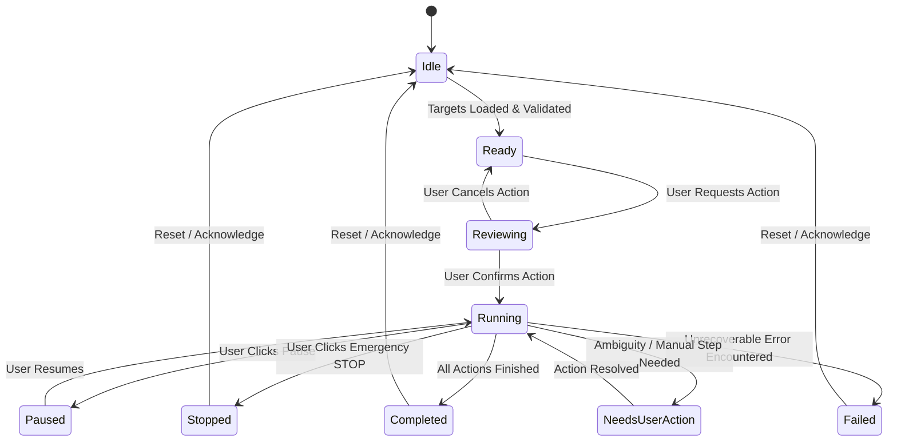

# Day 1: Architecture & State Machine Specification
**Project:** Appilot Snapchat Companion  

---

## 1. System State Machine

The entire orchestrator and UI operate around a deterministic, finite state machine:

### State Definitions
* **`IDLE`**: No active task. Waiting for user input or target selection.
* **`READY`**: System has validated curated targets and device connection.
* **`REVIEWING`**: Consequential action confirmation screen is presented to user (FR-05).
* **`RUNNING`**: Active execution (demo simulation or reminder dispatch).
* **`PAUSED`**: Execution paused temporarily by user.
* **`STOPPED`**: Emergency STOP invoked. All pending actions aborted immediately.
* **`COMPLETED`**: Workflow successfully finished with all outcomes accounted for.
* **`FAILED`**: Action failed due to technical error (e.g. device disconnected, timeout).
* **`NEEDS_USER_ACTION`**: System pauses when human intervention is needed.

---

## 2. Real-Time WebSocket Protocol

### Channel 1: Android Device (`/ws/device`)
* **Device → Server**:
  * `DEVICE_HELLO`: Device reports model, Android version, AccessibilityService status.
  * `WINDOW_STATE_CHANGED`: Active package name (e.g. `com.snapchat.android`), UI screen detected.
  * `ACTION_RESULT`: Outcome of requested assisted action (`COMPLETED`, `FAILED`, `UNKNOWN`).
  * `HEARTBEAT`: Periodic ping with timestamp.
* **Server → Device**:
  * `STOP_COMMAND`: Force stop any ongoing assisted interaction.
  * `SIMULATE_STEP`: Send guided step (highlight element, trigger vibration, test node).

### Channel 2: Frontend Dashboard (`/ws/client`)
* **Client → Server**:
  * `START_WORKFLOW`: Initiates workflow with selected target IDs.
  * `CONFIRM_ACTION`: Explicit user confirmation after review.
  * `PAUSE_WORKFLOW`: Pause execution.
  * `RESUME_WORKFLOW`: Resume execution.
  * `STOP_WORKFLOW`: Emergency stop.
  * `TRIGGER_DEMO`: Run deterministic synthetic test suite.
* **Server → Client**:
  * `STATE_UPDATE`: Broadcasts current orchestrator state.
  * `DEVICE_UPDATE`: Current connected ADB / WebSocket device info.
  * `AUDIT_LOG`: Real-time streaming log entry.
