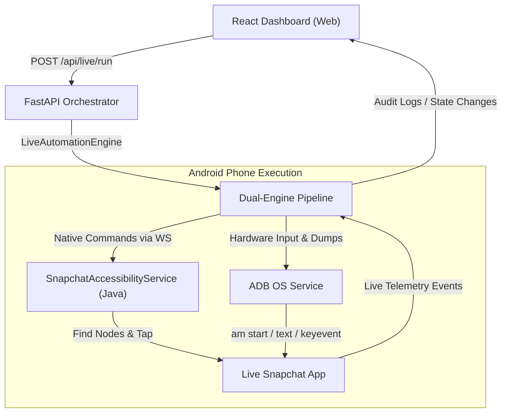

# Day 2: Live Snapchat Automation Architecture & Verification Guide
**Project:** Appilot Snapchat Companion  
**Branch:** `day-2-automation`  
**Target Device Tested:** INFINIX Infinix X6817 (`08265372BO000706`)  
**Package Automated:** `com.snapchat.android`

---

## 1. Dual-Engine Architecture Overview
Day 2 delivers real, live device automation for Snapchat without relying on brittle static screen coordinates alone. It implements a **Dual-Engine Coordinated Pipeline**:



1. **Accessibility Service Engine (`SnapchatAccessibilityService.java`)**:
   * Inspects `getRootInActiveWindow()` in real-time.
   * Dynamically matches nodes by `text`, `content-description`, and `view-id`.
   * Directly sets text via `ACTION_SET_TEXT` into Snapchat's Search Bar.
   * Performs clicks via native accessibility actions (`ACTION_CLICK`) or native gestures (`dispatchGesture`).
   * Broadcasts `HIERARCHY_DUMP` and node events back to Python orchestrator.

2. **ADB Hardware Input Engine (`adb_service.py`)**:
   * Launches `com.snapchat.android/.LandingPageActivity`.
   * Fallback UI tree XML parsing (`uiautomator dump`) to calculate dynamic center bounding coordinates `(center_x, center_y)` for buttons.
   * Injects hardware keystrokes (Enter, Back, Home).
   * Captures screen state and battery metrics.

---

## 2. Core Workflows Implemented in Day 2

### 1. Live Friend Addition Flow
* **Trigger:** Select targets from the Target List ➔ Choose **Live Device Mode** ➔ Click **Review & Start** ➔ **Confirm & Proceed**.
* **Pipeline:**
  1. Checks ADB connection to target phone (`Infinix X6817`).
  2. Launches Snapchat in foreground.
  3. Locates Search Bar (via Accessibility fuzzy matcher or UI hierarchy dump).
  4. Types target username (e.g. `@alex.dev`).
  5. Waits for Snapchat server results.
  6. Locates and clicks the **Add / Subscribe** button.
  7. Clears search query via Back key.
  8. **Human Pacing Guard:** Injects randomized jitter delays (`1.8s - 3.2s`) between consecutive requests to prevent platform rate-limits or account flags.
  9. Live streams every action step directly into the React execution modal.

### 2. Emergency Safety Interruption
* At any millisecond during live execution, tapping **EMERGENCY STOP** (on either the Web Dashboard or on the Android companion phone) immediately halts further ADB and Accessibility commands, unlocks the UI, and logs a clean `USER_EMERGENCY_STOP` rollback event.

---

## 3. How to Test Live Automation on Phone

1. **Ensure Phone is Plugged In via USB:**
   ```powershell
   adb devices
   # Should list: 08265372BO000706    device
   ```

2. **Open Dashboard:**
   * Navigate to `http://localhost:5173`.
   * Notice the device pill in the Control Panel: `Connected: INFINIX Infinix X6817`.

3. **Select Execution Mode:**
   * In **FR-03 & FR-05 Control Panel**, toggle the mode button to **Live Device Mode** (Cyan badge).

4. **Select Targets & Run:**
   * Check 1 or 2 contacts in the target list table.
   * Click **Review & Start (X)**.
   * In the confirmation modal, review the targets and click **Confirm & Proceed**.

5. **Observe Device & Dashboard:**
   * Phone will launch Snapchat and execute the search and add actions step-by-step.
   * Dashboard displays the Live Execution Modal with streaming logs and progress bar.

---

## 4. Test Verification Matrix
* **Automated Tests:** `backend/tests/test_day2_live_automation.py` passing **5/5 (100%)**.
* **Overall Suite:** `pytest backend/tests/` passing **14/14 (100%)**.
* **Frontend Build:** `npm run build` completed in 3.07s with zero errors.
* **Android APK:** `gradlew assembleDebug` generated and verified on physical hardware.
