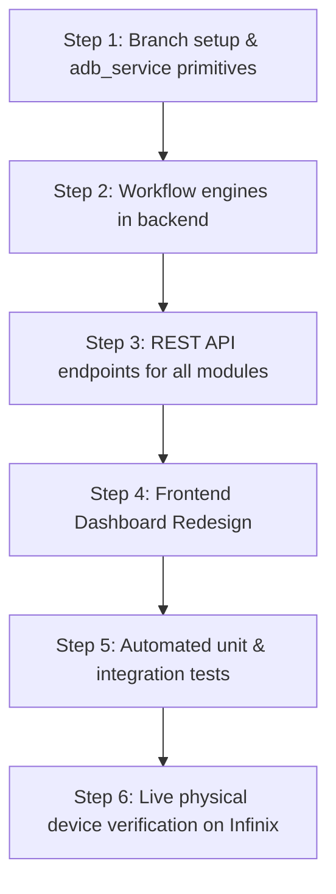

# Day 3 Engineering Roadmap: End-to-End Core Features, Anti-Ban Human Engine & Non-Technical Dashboard

**Branch:** `day-3-resilience`  
**Target Device:** `INFINIX Infinix X6817` (`08265372BO000706`), Android 12  
**Target App:** `com.snapchat.android`

---

## 1. Feature Architecture & Research Analysis

### Feature 1: Multi-Modal Bulk Follow & Add
Snapchat provides 3 distinct paths to connect with users:
1. **Target Search Follow:** Search by exact username, verify user card, tap `Add` with organic finger tap.
2. **Quick Add / Suggestions:** Open the Add Friends screen (`neon_add_friend_button_container`), parse the `Quick Add` section, and sequentially tap `+ Add` with organic human jitter (1.8s - 3.2s) and gentle scrolling.
3. **Accept Incoming Requests:** On the Add Friends screen, detect the `Added Me` section and tap `Accept` for pending follower requests.

---

### Feature 2: Bulk Un-Follow with Smart Engagement Filters
Snapchat friendship management requires navigating to the friendship profile or long-pressing on the Chat feed row:
* **Filter A (No Active Streak):** Scans friend entries in the Chat tab. If the row lacks the flame emoji (`🔥`) or streak count, it qualifies for removal.
* **Filter B (Inactivity Threshold):** Evaluates last interaction badges (`3w ago`, `1mo ago`, `2mo ago`, etc.). Friends exceeding the user-configured day threshold (e.g. >17 days) are queued for review/removal.
* **Filter C (Targeted Custom List):** User-selected usernames to unfollow.
* **Action Sequence:** Long-press friend row ➡️ Tap `Manage Friendship` ➡️ Tap `Remove Friend` ➡️ Tap confirmation modal `Remove`.

---

### Feature 3: Auto Snap Sender with Random Artistic Filters & Recipient Dispatch
* **Capture:** From camera landing, triggers hardware capture (`camera_capture_button`).
* **Random Filter Injection:** Simulates human finger swipes across the preview screen (`input swipe 600 800 200 800 350`) to apply a random artistic color/lens filter.
* **Send To Screen:** Taps the circular yellow `Send To` arrow.
* **Recipient Selection:** 
  - Option to tap `All Friends` / Best Friends / Shortcuts.
  - Or tap individual selected contacts.
* **Dispatch:** Taps the blue/yellow `Send` pill. Screen automatically returns cleanly to `CAMERA_LANDING`.

---

### Feature 4: Snapscore Booster Research & Implementation
* **How Snapchat Calculates Snapscore:**
  $$\text{Snapscore} = \text{Snaps Sent} + \text{Snaps Received/Opened} + \text{Bonus Points (Multi-Recipients, Streaks, Story Posts)}$$
  * **Critical Fact:** Plain text chat messages do **NOT** count towards Snapscore. Only camera Snaps count.
  * Sending 1 Snap to 10 friends can add 10 points!
  * **Appilot Booster Loop:** 
    $$\text{Capture Snap} \longrightarrow \text{Apply Filter} \longrightarrow \text{Select All / Multi-Friends} \longrightarrow \text{Send} \longrightarrow \text{Anti-Ban Human Rest} \longrightarrow \text{Repeat Cycle}$$
  * Configurable cycles (e.g. 5, 10, 20 snaps) with safety pacing to prevent rate limits or account flags.

---

### Feature 5: Chained & Scheduled Automation
Allows users to run operations in standalone mode or chain them into a combined sequence:
* **Workflow A:** `Auto Snap Sending` ➡️ Rest 15s ➡️ `Quick Add Suggestions`.
* **Workflow B:** `Snapscore Booster (10 cycles)` ➡️ Rest 20s ➡️ `Clean Inactive Friends`.
* **Workflow C:** `Full Daily Routine` (Accept Requests ➡️ Send Streak Snaps ➡️ Quick Add 5 New Friends).

---

### Feature 6: Anti-Ban Human Behavior & Interruption Resilience
1. **Touch Contact Durations:** Uses swipe-in-place with 60ms-115ms touch contact time, never instantaneous 0ms robotic taps.
2. **Spatial Bounding Box Margins:** Calculates element bounds and taps with random Gaussian-distributed offset within the inner 70% of the element.
3. **Keystroke Jitter:** Character-by-character typing with 80ms-180ms delay.
4. **Visual Scanning & Hesitation Delays:** 2.2s - 3.5s visual scanning pauses when viewing search results or friend lists.
5. **Top System Notification Handling:** If a heads-up banner or notification drops from the top of the screen, swipes up to dismiss it.
6. **In-App Popup Resilience:** Senses any dialog overlay, dismisses via Cancel/Not Now/Back, and returns to track without aborting the workflow.

---

### Feature 7: Modern, Non-Technical Dashboard Redesign
A completely revamped, intuitive UI for everyday, non-technical users:
* **Large Visual Cards:** Clear emojis, friendly titles, and straightforward toggles.
* **Modular Tabs:**
  - 👥 **Add & Grow** (Search Add / Quick Add Suggestions / Accept Requests)
  - ✂️ **Cleanup & Unfollow** (Streak filter, Inactivity days slider, Targeted removal)
  - 📸 **Auto Snap & Streaks** (Random filter toggle, Select All toggle, Instant send)
  - ⚡ **Snapscore Booster** (Cycle counter, Start Booster)
  - 🔄 **Chained Automation** (One-click daily routine)
* **Distraction-Free Audit Log:** Only user-meaningful progress entries with clear green/red status badges; zero technical internal log spam.

---

## 2. Step-by-Step Implementation Roadmap

1. **Step 1:** Implement core ADB & Accessibility primitives in `adb_service.py`:
   - Quick Add & Accept Requests handlers.
   - Snap photo capture, filter swiping, recipient selection, and dispatch.
   - Chat list traversal, streak detection, and friend removal sequence.
   - Heads-up notification dismissal.
2. **Step 2:** Build dedicated workflow services in `backend/app/services/`:
   - `bulk_follow_engine.py`
   - `bulk_unfollow_engine.py`
   - `auto_snap_engine.py`
   - `snapscore_engine.py`
   - `chained_workflow_engine.py`
3. **Step 3:** Expose REST & WebSocket endpoints in `backend/app/main.py`.
4. **Step 4:** Redesign frontend UI in `frontend/src/` with modern cards, tabbed controls, and simplified plain-language copy.
5. **Step 5:** Run full test suite (`pytest`) covering all new workflows and edge cases.
6. **Step 6:** Validate live on physical Infinix device and push to `origin/day-3-resilience`.
